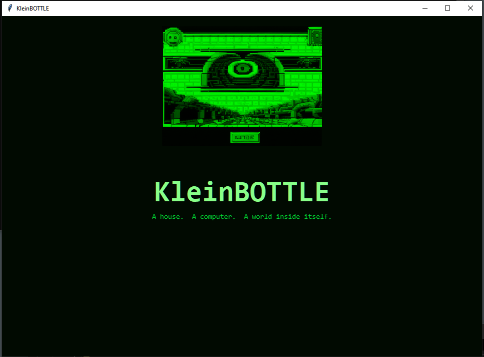
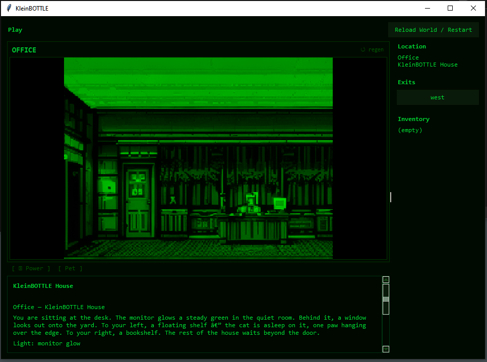
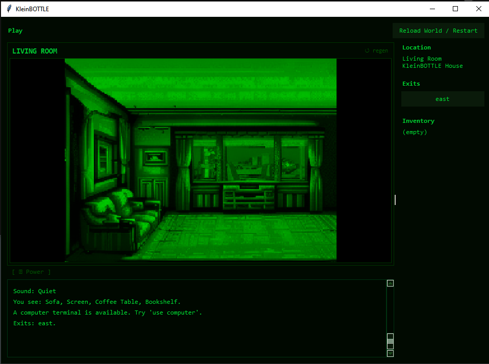

# KleinBOTTLE

> *You are sitting at a desk. The monitor glows a steady green.  
> Interact with the computer — and a world opens inside itself.*

## Screenshots







A recursive text adventure / retro desktop hybrid. The house contains a PC. The PC contains a text adventure. The text adventure contains a PC. Loop complete.

---

## Quick Start

**Windows (first time):**

```bat
setup_env.bat
run.bat
```

**Linux / macOS (first time):**

```sh
./setup_env.sh
./run.sh
```

Or directly: `python -m kleinos`

---

## What Happens When You Run It

1. **Title screen** — press Enter, Space, or click to begin.
2. **Text adventure** — you wake in a home office. Explore the house. Find the computer on the desk.
3. **`use computer`** — opens **KleinOS**, a retro desktop with its own apps and games.
4. Inside KleinOS, launch **KleinBOTTLE** from the Games shelf — you're back in the adventure. The loop closes.

---

## The House — Ten Rooms

```
Office ──── Hall ──── Living Room
  │                       │
(klein_pc)             Kitchen ──── Back Yard ──── Back Woods ──┐
                           │                                     │
                       Bedroom ── Bathroom          Front Woods ─┘
                                                        │
                           Front Yard ──────────────────┘
                               │
                            (front door)
```

Woodland paths loop — leaving one gate returns you through the other (a Klein bottle in structure).

---

## Text Adventure Commands

| Command | Shortcut | Action |
|---------|----------|--------|
| `look` | `l` | Describe current room |
| `inspect <object>` | `x`, `examine`, `look at` | Examine an object |
| `go <exit>` | exit name alone | Travel through named exit |
| `enter <exit>` / `leave` | — | Alternate travel phrasing |
| `take <item>` | `get`, `pick up` | Pick up an item |
| `drop <item>` | — | Drop carried item |
| `inventory` | `i`, `inv` | Show carried items |
| `use computer` | — | Open the KleinOS PC |
| `answer phone` | — | Start Ollama telephone conversation |
| `hang up` | — | End phone call |
| `help` | `?` | Show command list |
| `Reload World` | — | Restart from latest saved JSON |

---

## KleinOS

A retro desktop that opens when you interact with the in-game computer. Divided into **Apps**, **Games**, and **Settings**.

### Apps

#### World Builder
Design and edit the game world. Add/remove rooms, set descriptions, connect exits, place objects and actors. Changes are saved to `data/world.json` and loaded live with `Reload World` in the adventure.

#### KleinCHAT
Chat with a local **Ollama** LLM running on your machine. Requires Ollama installed with a model pulled (e.g. `ollama pull qwen2.5:3b`). Full conversation history with a styled transcript pane.

#### Notes
In-game notepad. Add notes, list them, clear all. Use it to track clues, door codes, or anything else you want to remember across sessions.

---

### Games

#### MAHisLAND  `Survive. Build. Claim the land.`
Arcade pixel-art survival on a small island.

| Input | Action |
|-------|--------|
| `← ↑ → ↓` / WASD | Move |
| Hotbar `1` | Equip Fist — swing to attack |
| Hotbar `2` | Equip Hammer — place building blueprint |
| Hotbar `3` | Eat food (consumable — does not change equipped tool) |
| `R` | Open build menu |
| `RMB` | Use / interact — opens doors, gates, chests |
| `ESC` | Confirm-exit dialog (saves score) |

Scoring and high score are tracked across runs. Resume on restart picks up where you left off.

#### The Shack  `An abandoned shack in the woods. Something is hidden beneath it.`
A self-contained text adventure. Classic parser. Explore the shack and find what's buried.

#### KleinBOTTLE  `Play the KleinBOTTLE text adventure.`
The same house world you're already in — now running inside the PC inside the house. Full recursive loop.

#### NULL Invaders  `Blast the invaders before they breach the null line.`
Retro space invaders. Waves of descending invaders. Don't let them cross the null line.

| Input | Action |
|-------|--------|
| `← →` / A D | Move ship |
| `Space` / `Enter` | Fire |
| `Escape` | Exit |

---

### Settings

Four-tab settings panel accessible from the KleinOS sidebar.

#### Display
Choose the phosphor color theme applied to the entire UI:

| Color | Label |
|-------|-------|
| Green (default) | Green Phosphor |
| Amber | Amber Phosphor |
| White | White Phosphor |
| Blue | Blue-White Phosphor |
| Red | Red Phosphor |

#### Sound
Per-effect volume sliders: Shoot, Invader hit, Explosion, Player hit, Player death, Alien step.

#### Keybinds
Reference table for game controls (Move, Fire/Select, Exit).

#### Navigation
Manage the KleinOS sidebar — add, rename, or delete categories/shelves to organize your apps and games.

---

## Room Images

Each room gets a **generated retro pixel-art background** (Sierra/LucasArts style) displayed above the transcript, rendered in green phosphor monochrome. Images scale proportionally to the window width (4:3 aspect ratio, max 400 px tall).

**Requirements:** ComfyUI running at `http://127.0.0.1:8188`.  
(Stability Matrix → Launch ComfyUI)

Images are generated on first visit and cached to `data/rooms/<room_id>.png`. Use the **↺ regen** button in the banner to regenerate the current room's image at any time.

Pre-generate all 10 rooms at once:

```bat
python scripts\gen_room_images.py
```

Pass `--regen` to overwrite existing cached images.

---

## Telephone / Ollama (optional)

Install Ollama and pull a model:

```sh
ollama pull qwen2.5:3b
```

Add an object with `"kind": "telephone"` to any room using the World Builder. In Play, type `answer phone` to start a conversation. `hang up` to end it.

---

## World JSON

The world lives in `data/world.json`. Edit it in the **World Builder** app (inside KleinOS) or directly in a text editor. Each room has:

```json
{
  "id": "office",
  "name": "Office",
  "area": "inside",
  "description": "...",
  "exits": { "north": "hall" },
  "objects": [{ "id": "klein_pc", "name": "computer", "kind": "terminal" }],
  "actors": []
}
```

An object with `"kind": "terminal"` triggers the KleinOS PC hook when the player uses it.  
An object with `"kind": "telephone"` triggers the Ollama telephone hook.

---

## Setup

### Dependencies

| Package | Purpose |
|---------|---------|
| `pillow` | Room images and splash screen (green phosphor tint) |
| `tkinter` | UI (Python stdlib) |
| ComfyUI | Local image generation (optional — game runs without it) |
| Ollama | Telephone NPC conversations (optional) |

`setup_env.bat` / `setup_env.sh` creates a `.venv` and installs Pillow automatically.

### Image generation pipeline

Room and splash images use the pipeline at `C:\Jacob\Apps & Tools\image-generation-pipeline`. The pipeline calls ComfyUI's API and applies the `R3TR0` LoRA trigger word for retro pixel art style. Without ComfyUI running, images simply won't generate — the game and all other features work normally.

---

## Architecture

```
kleinos/
  __main__.py         Title screen → text adventure → KleinPC hook
  kb_surfaces.py      KleinAdventurePane: room image banner + GameSurface
  room_panel.py       Full-width room image panel; ComfyUI pipeline integration
  klein_pc.py         KleinOS desktop window (apps/games/settings sidebar)
  mahisland.py        MAHisLAND arcade survival game
  adventure.py        The Shack standalone text adventure
  chat_pane.py        KleinCHAT — Ollama conversation UI
  game_pane.py        NULL Invaders space shooter
  settings_pane.py    Four-tab settings panel (Display/Sound/Keybinds/Navigation)
  terminal_pane.py    KleinOS terminal with built-in mini-shell
  audio.py            Sound effect engine
  config.py           Persistent settings (phosphor color, volumes)

src/
  game.py             Text adventure parser and session state
  world_model.py      World JSON contract and validation
  surfaces/
    game.py           Transcript UI and command input
    builder.py        World editor UI

data/
  world.json          KleinBOTTLE house world definition
  splash.png          Title screen pixel art (generated, green phosphor tinted)
  rooms/              Cached room background images (generated by ComfyUI)

scripts/
  gen_room_images.py  Batch pre-generate all room backgrounds
```
